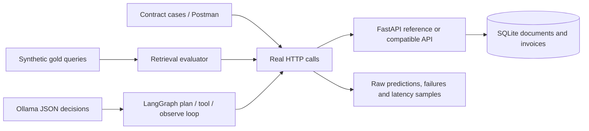

# ProbeFlow

> **Career-search extension under development.** Public Lever feed ingestion, profile
> extraction, multi-tool conversation memory, and comparative evaluation are available
> locally. A live local Ollama agent run is documented below. There is no deployed
> persistent index or hosted scheduler. The API requires one shared key and is intended for
> a private/local demo, not multi-user production use.

## Career-search extension quickstart

### Real-posting retrieval evaluation

On 17 November 2026 a local snapshot captured 375 published Lever postings:
250 from Palantir, 51 from Weekday and 74 from ShopBack. A Zoox feed failed
normalization and is excluded. The author selected two plausible postings by
title and location for each of 25 manually written queries, giving 50 positive
judgments. This is an incomplete, positive-only label set: unjudged postings
are treated as nonrelevant, and no work-authorization assessment was made.

Against this fixed snapshot, using `nomic-embed-text`, BM25 achieved Recall@10
0.840 and MRR@10 0.631. Hybrid achieved Recall@10 0.840 and MRR@10 0.648.
These are approximate scores against author-selected positives, not a measure
of hiring-market relevance, eligibility, or real-user satisfaction. No
candidate profiles were used in this run, so profile-signal ablations are not
informative. See `fixtures/real_job_queries.json` and
`evaluation/real_jobs_summary.json` for judgment details and the snapshot hash.

To repeat the exact evaluation, retain the local
`artifacts/real_jobs_snapshot.json` captured for this run, install Ollama with
`nomic-embed-text`, and run `python scripts/evaluate_real_jobs.py`. The evaluator
refuses a snapshot whose SHA-256 differs from the labeled one. A new snapshot
from `python scripts/fetch_real_jobs_snapshot.py` requires fresh relevance
judgments because job boards change. Posting excerpts are not bundled in the
repository. Feed availability and provider behavior can change.

Set `PROBEFLOW_API_KEY` and launch the reference API as below. To ingest a curated
set of public Lever boards, set `PROBEFLOW_LEVER_BOARDS` to a JSON array such as
`[{"site":"example","company":"Example","region":"global"}]` and send an
authenticated POST to `/v1/internal/ingest`. The endpoint uses only read-only
published Lever postings. Configure your own scheduler to call it periodically.
`/v1/ingestion/health` reports attempts and active source records. A complete
successful fetch is required before missing jobs are marked stale. Search returns
source links and filters stale records. If `PROBEFLOW_EMBEDDING_MODEL` is configured,
refreshes index embeddings and reuse vectors for unchanged content and model.
Failed embedding calls leave the posting searchable lexically and are counted
in the refresh response so a later run can retry them. Search reports vector coverage.

To refresh without an HTTP request, run `python scripts/refresh_job_index.py`.
Add `--interval-seconds 3600` to repeat while the process runs. It stops when
the process exits and should be supervised by a service manager for unattended
operation. The program does not install a scheduler or run automatically.

`python scripts/verify_live_career.py` fetches the public Weekday Lever board,
indexes it with the local `nomic-embed-text` model, and runs two turns through
the local `qwen2.5:1.5b` planner. It checks search, source links, the requested
follow-up detail, and retained conversation/tool records using synthetic candidate
data. Models must already be installed in Ollama. Feed availability and counts
change. The run writes local evidence to `artifacts/live_career_verification.json`.
On 17 November 2026 a local run indexed 51 postings, returned a software intern
as the top result for a synthetic candidate profile, and retrieved that posting
in the follow-up. See `evaluation/live_career_summary.json` for the recorded
counts and model names. This is one run, not a measure of general relevance.

For resume extraction set `PROBEFLOW_RESUME_MODEL` to a locally installed Ollama
model and send resume text to `/v1/resume/match` with the API key. The raw text is
not saved, but the extracted candidate profile is stored in SQLite. For agent
planning set `PROBEFLOW_AGENT_MODEL` and call `/v1/jobs/agent-search`. Conversation
history and tool responses are stored locally. Protect the database and API key.
The agent has bounded read-only search, detail, and comparison tools.

Run `python scripts/evaluate_job_search.py` for BM25, embedding, hybrid, and
ablation tables. The included six-query fixture is synthetic. Embedding rows
are marked unavailable unless an Ollama embedding model is configured. Run
`python scripts/evaluate_agent_judge.py` after setting `PROBEFLOW_JUDGE_MODEL`
and starting Ollama to compare judge outputs against 20 author-curated synthetic
examples. This is not a human-subject or real-user quality study.

The existing Dockerfile runs the API with SQLite. Vercel's ephemeral filesystem
is not durable storage for postings or conversations. A managed database,
authentication, model hosting, and a protected scheduler are needed before a
public deployment can provide persistent multi-user service.

Python API quality workbench for OpenAPI driven fuzzing, contract tests,
retrieval evaluation, SQL reconciliation and bounded LLM assisted investigation.
Built as a local portfolio project on November 1, 2026. All reference data is
synthetic.

## What works

- Reusable HTTP test cases with status, nested JSON value and strict value-type assertions. It records both defects and transport errors.
- FastAPI reference service with a typed answer contract, JSON/XML document ingestion, SQLite FTS5/BM25 retrieval and relational invoice/vendor rollups.
- Tests reconcile API totals against the actual SQL database. Negative checks cover authentication, input boundaries, malformed XML, external XML entities and document index consistency.
- A LangGraph state graph calls an Ollama structured-output adapter, validates each decision with Pydantic, executes approved read-only HTTP checks and returns observations to the model. It rejects unknown tools and bounds execution to a configurable step budget.
- Twenty Postman requests and a matching JSON contract suite.
- OpenAPI 3.x/JSON/YAML imports use Schemathesis and Hypothesis to generate inputs from API contracts. Read-only GET, HEAD, OPTIONS and TRACE operations are included by default. A POST is tested only when its operation carries `x-probeflow-safe: true`; PUT, PATCH and DELETE stay out of the run. Generated checks have fixed time, request and rate limits, one worker, and redirects disabled.
- Each OpenAPI run exports JUnit XML, machine readable JSON and an offline HTML report. API tokens flow from named environment variables through a generated Schemathesis config; the config stores placeholders, never token values. Tokens stay out of command-line arguments and saved schemas. Reports remain local and may contain response data from the API under test, so review them before sharing.
- Evaluation of twenty explicit synthetic queries: recall@3, MRR@3, citation-id validity and answerable/unanswerable abstention. Every prediction is retained.
- Concurrent HTTP load driver with raw samples, status counts, p50/p95/p99 latency, environment metadata and an explicit workload boundary.
- Pytest JUnit output and a GitHub Actions workflow that retains quality artifacts. The workflow is provided in source; a hosted Actions run has not been performed.

## Start locally (PowerShell)

```powershell
python -m venv .venv
& .\.venv\Scripts\python.exe -m pip install -e '.[dev]'
$env:PROBEFLOW_API_KEY = 'choose-a-local-test-key'
& .\.venv\Scripts\python.exe -m uvicorn probeflow.reference_api:create_app --factory --port 8765
```

In another terminal with the same API key environment variable:

```powershell
& .\.venv\Scripts\python.exe -m pytest -q --junitxml=artifacts/pytest.xml
& .\.venv\Scripts\python.exe -m probeflow.cli suite --out artifacts/contracts.json
& .\.venv\Scripts\python.exe -m probeflow.cli evaluate --out artifacts/retrieval.json
& .\.venv\Scripts\python.exe -m probeflow.cli benchmark --requests 300 --concurrency 10 --out artifacts/benchmark.json
& .\.venv\Scripts\python.exe -m probeflow.cli openapi --schema openapi/probeflow-readonly.json --target-url http://127.0.0.1:8765 --header-env X-API-Key=PROBEFLOW_API_KEY --max-examples 20 --max-time 30 --out artifacts/schemathesis-result.json
```

Or use one isolated validation command; it creates its own database, temporary
API key and local server, and shuts down that server when finished:

```powershell
& .\.venv\Scripts\python.exe scripts/validate.py --schemathesis --newman
```

The optional `--newman` flag requires Node/npx and downloads Newman if absent.
The `--schemathesis` flag runs the OpenAPI generated suite and creates its JUnit,
JSON and HTML reports. The sample spec exercises three read-only operations.
Import `postman/ProbeFlow.postman_collection.json` into Postman to inspect and
run the same requests interactively.

For a different service, pass its OpenAPI file to `--schema`, set `--target-url`
to the development or staging API, and name an environment variable with
`--header-env`, such as `--header-env Authorization=STAGING_BEARER_TOKEN`. Set
the variable in your terminal before starting the run. Operations such as POST
are excluded by default; mark a POST with `x-probeflow-safe: true` only if it has
no side effects. Keep fuzz runs to services you control and never send generated
requests to production.

## Optional live LLM investigation

Start a local Ollama instance and install a model supporting JSON-schema output.
Then run:

```powershell
& .\.venv\Scripts\python.exe -m probeflow.cli investigate --model qwen2.5-coder:1.5b --out artifacts/live_model.json
```

The automated tests use controlled model decisions and real HTTP tools. They
prove graph routing, schema/error handling, check restrictions and execution
bounds. They do not prove a real model's diagnosis quality. A live-model trace
must be collected before claiming measured LLM performance.

## Architecture



## Scope and interpretation

The reference answer service returns retrieved document excerpts. It does not
call an LLM or perform dense/vector retrieval. The original defect-investigation
LLM is an optional planner; the job-search planner is separately bounded to
typed plans and three allowlisted read-only tools. Benchmark results include the
local HTTP/SQLite path and exclude model inference. Results on six synthetic
policy documents and twenty questions are fixture checks, not evidence of
general RAG accuracy, real healthcare deployment or production scale. Citation
validity checks document identifiers; it does not establish semantic entailment.

## Candidate job search extension

ProbeFlow also includes a job-search vertical built on the same API and
evaluation approach. It stores jobs by stable ID, updates the FTS5 index in the
same operation, keeps an explicit candidate profile (roles, skills, locations,
and remote preference), and returns ranked results with score explanations.
When an embedding provider is configured, retrieval combines its vectors with
FTS5 BM25 ranking and profile-based skill, role, and location signals. Without
an embedding service, the API reports lexical/profile ranking instead of
pretending that semantic retrieval ran.

The optional Ollama adapters provide embeddings and structured search planning.
The LangGraph flow reads the saved profile and exposes three allowlisted
read-only tools: search, details, and comparison. Search results come from
indexed postings, and the returned summary is deterministic.
The local Ollama model must be installed separately. The API does not download
models or send profile data to a hosted provider.

Run the synthetic labelled retrieval evaluation with:

```powershell
& .\.venv\Scripts\python.exe scripts/evaluate_job_search.py
```

To enable vector retrieval and natural-language planning, install and start
Ollama, pull an embedding model and a JSON-schema-capable chat model, then set
`PROBEFLOW_EMBEDDING_MODEL`, `PROBEFLOW_AGENT_MODEL`, and optionally
`PROBEFLOW_OLLAMA_URL` before starting the API. Re-upsert jobs after changing
the embedding model so all records share one vector space. The checked-in
evaluation dataset is synthetic and small; its scores are regression signals,
not evidence of marketplace quality, fairness, or user outcomes.

Docker and CI configuration are included. No cloud deployment,
professional certification, production customer adoption or clinical capability
is claimed.

## Recorded local validation - November 1, 2026

| Check | Observed result | Artifact |
| --- | --- | --- |
| Pytest, including the HTTP API and schema generated checks | 56 passed | `artifacts/pytest.xml` |
| JSON contract suite against the running server | 20/20 passed | `artifacts/contracts.json` |
| Newman/Postman collection | 20 requests, 36 assertions, zero failures | `artifacts/newman-summary.json`, `artifacts/newman.xml` |
| Schemathesis against 3 safe OpenAPI operations | 141 generated cases, 141 passed, 0 failures in a 30 second run | `artifacts/schemathesis-result.json`, JUnit and offline HTML paths inside the file |
| Retrieval fixtures | 15 answerable and 5 unanswerable queries; raw responses retained | `artifacts/retrieval.json` |
| Concurrent HTTP measurement | 300 requests, 10 concurrent clients; 300 HTTP 200 responses | `artifacts/benchmark.json` |

The retrieval fixture metrics were 1.0 for recall@3, MRR@3, abstention correctness
and citation-id validity. These are tiny synthetic fixture results. The PDF uses
sample counts and test coverage scope, rather than presenting them as real-world
model accuracy. The load run is short and local, not a sustained capacity test.
A local Ollama service was unavailable during validation, so no live model run
or model diagnosis-quality result is reported.

## Interview walkthrough

1. Run a known-good contract, change one expected value and inspect the reported failure.
2. Demonstrate XML entity rejection and explain the difference between validation and authentication.
3. Trace the vendor `LEFT JOIN`, conditional `SUM` and zero-invoice case, then reconcile the HTTP response against SQLite.
4. Explain recall versus reciprocal rank, why an unanswerable query should abstain, and why valid citation ids do not prove a truthful answer.
5. Inspect the LangGraph decision schema, read-only check restriction and step-limit behavior.
6. Explain local benchmark boundaries and inspect individual raw latency samples.

Open source components are installed as dependencies and credited in
`THIRD_PARTY_NOTICES.md`. Schemathesis is MIT licensed; its API test runner is
integrated with upstream attribution preserved.


